# 植物种植花期资料库 v1.1.0 使用说明

这是一个本地运行的植物资料管理工具，用于记录植物档案、花期、养护方法、常见病害，并提供网络图片搜索和 AI 辅助。本文档与演示视频位于同一目录。

## GitHub 下载地址

- 仓库主页：<https://github.com/RespateG/web-plant-ai>
- 直接下载源码：<https://github.com/RespateG/web-plant-ai/archive/refs/heads/main.zip>

```bash
git clone https://github.com/RespateG/web-plant-ai.git
cd web-plant-ai
```

## 安装方法

环境要求：Python 3.8 及以上。

```bash
# 建议使用虚拟环境
python3 -m venv .venv
source .venv/bin/activate

# 安装依赖
pip install -r requirements.txt
```

Windows 激活虚拟环境：

```powershell
.venv\Scripts\activate
```

## 启动方法

```bash
python3 main.py
```

启动后浏览器访问：

```text
http://127.0.0.1:8002
```

首次访问会进入初始化注册页面。

常用命令：

```bash
# 指定端口
PLANT_PORT=8080 python3 main.py

# 按端口停止服务
python3 main.py stop

# 手动初始化数据库并查看统计
python3 main.py migrate
```

说明：

- 首次启动会自动创建 `data/` 目录和数据库，不需要手动导入数据。
- 局域网或服务器部署时，把访问地址中的 `127.0.0.1` 换为服务器 IP。
- 网络图片搜索和 AI 功能需要服务器能访问外网；离线时仍可手工填写和使用本地图片。

---

## 录制信息

| 项目 | 内容 |
| --- | --- |
| 软件版本 | v1.1.0 |
| 录制日期 | 2026-11-19 |
| 演示视频 | `plant-manage-v1-1-0.mp4` |
| 视频时长 | 3 分 54 秒 |
| 分辨率 | 1920×1080 |
| 字幕 | 中文旁白 + 独立 SRT |
| 初始数据 | 空白数据库，从注册和新增植物开始 |

---

## 1. 注册与登录

首次使用时系统没有账号，也没有植物和病害数据，需要先注册。

### 操作步骤

1. 打开系统地址，页面显示「初始化注册账号」。
2. 设置用户名，例如 `demo`。
3. 输入至少 4 位的密码，并再次输入确认。
4. 点击「完成注册」。

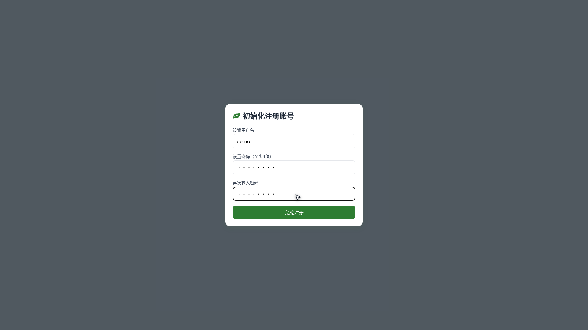

### 预期结果

注册成功后自动进入「我的种植」。由于是空白库，首页没有植物卡片，本月待办也为空。

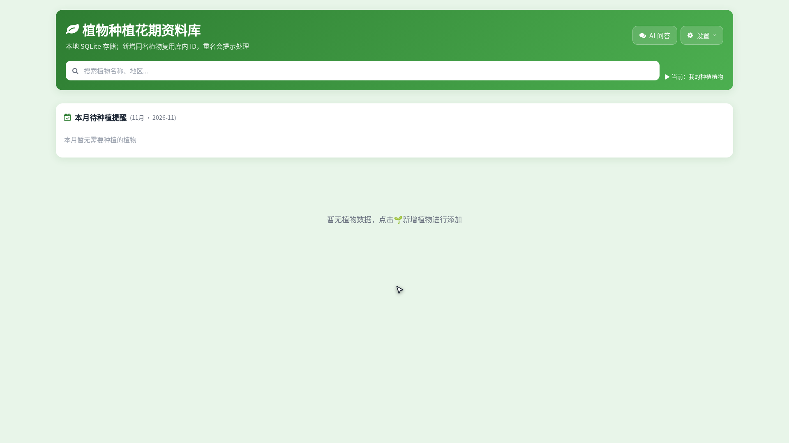

### 再次登录

1. 右上角「设置 → 退出登录」。
2. 在登录页输入用户名和密码。
3. 点击「登录」重新进入系统。

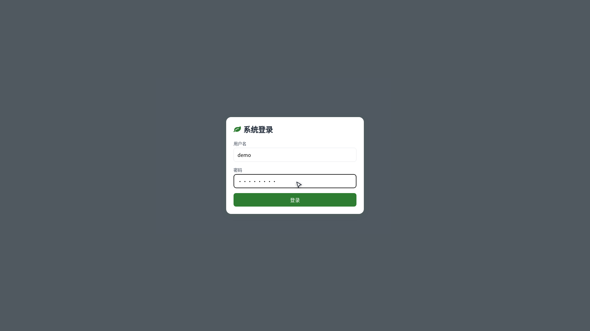

### 说明

- 账号只有一个，多人使用请共用同一账号。
- 登录状态会保持约 30 天，重启服务后通常不需要重新登录。
- 忘记密码时，需要在服务器数据目录重新初始化账号。

---

## 2. 新增植物

入口：右上角 **设置 → 🌱 新增植物**。

### 2.1 填写基本资料

| 字段 | 说明 |
| --- | --- |
| 植物名称 | 必填，例如「蓝雪花」 |
| 种植地区 | 如「长江流域」「华北」 |
| 种植时间 | 如「春季 3-4 月」 |
| 花期 | 如「5-10 月」 |
| 详细介绍 | 科属、形态、习性等 |
| 养护方法 | 光照、浇水、施肥、修剪、越冬 |
| 常见病害 | 从病害库中选择，可多选 |

保存规则：

- 名称与已有植物同名时，会复用已有资料。
- 同名记录较多时会提示先处理，避免覆盖错误。
- 新增到「我的种植」后，会参与每月的种植待办提醒。

### 2.2 选择植物图片

提供三种方式：

1. **选择本地图片**：自动压缩后保存。
2. **粘贴图片 URL → 加载 URL 图片**：系统自动读取并保存。
3. **网络图片**：按植物名称搜索候选图，点击即可选用。

网络图片操作：

1. 先填写植物名称「蓝雪花」。
2. 点击「网络图片」。
3. 系统展示最多 10 张候选图。
4. 点击任意一张即选用，自动压缩并回填预览。
5. 需要更多选择时点「换一批」。

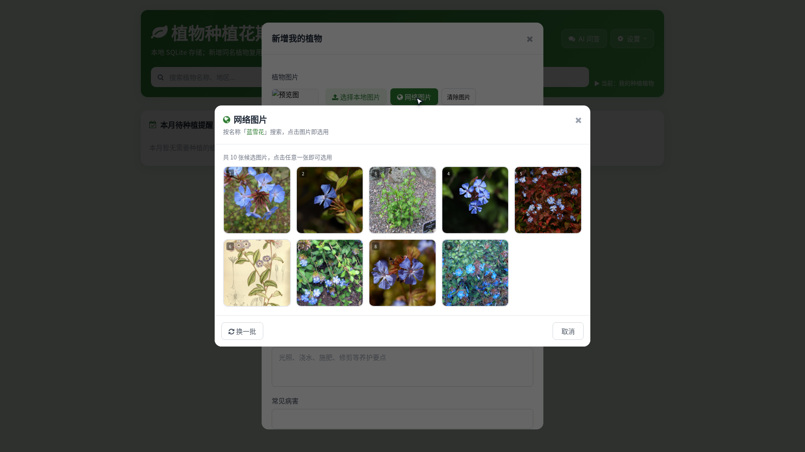

### 2.3 从库匹配补全

填写名称后点「🔍 从库匹配补全」，系统会从已有植物库复制地区、种植时间、花期、介绍、养护、病害和图片，适合重复添加同一种植物。

### 2.4 AI 补齐与自动补充病害库

填写植物名称后点 **✨ AI 补齐**，系统会自动生成：

- 种植地区、种植时间、花期；
- 详细介绍；
- 养护方法；
- 该植物常见病害。

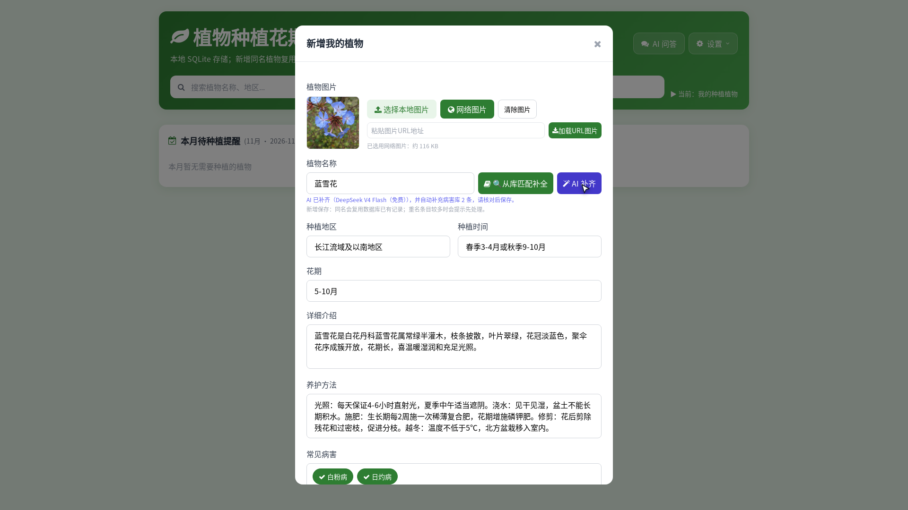

本次演示的病害库是空的，AI 推荐的「白粉病」和「日灼病」都会被自动创建：

- 自动写入症状、治理方法和预防措施；
- 自动出现在病害选择列表中并保持选中；
- 保存植物后可在病害库继续编辑。

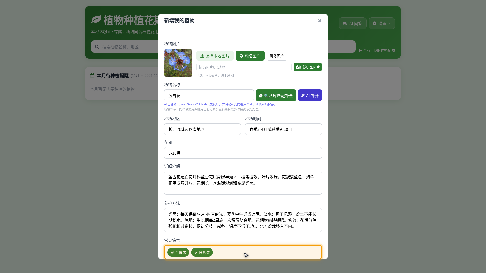

其他说明：

- 默认使用免费 AI；在「设置 → AI 设置」配置 Key 后使用自己的模型。
- 如果字段已有内容，会弹窗确认覆盖或只补空白项。
- 免费 AI 额度用尽时会弹窗提示，并给出配置指引。

---

## 3. 病害库

入口：右上角 **设置 → 🦠 病害库**，进入独立整页。

页面结构：

- 顶部：「新增病害」「返回植物列表」。
- 列表：显示病害名称、症状、治理方法、预防措施，以及「编辑 / 删除」。
- 新增/编辑：点击后在弹窗中填写：
  - 病害名称（必填）
  - 症状 / 现象（大文本框）
  - 治理方法（大文本框）
  - 预防措施（多行文本框）

本次演示开始时病害库为空，AI 补齐后自动加入了白粉病和日灼病。

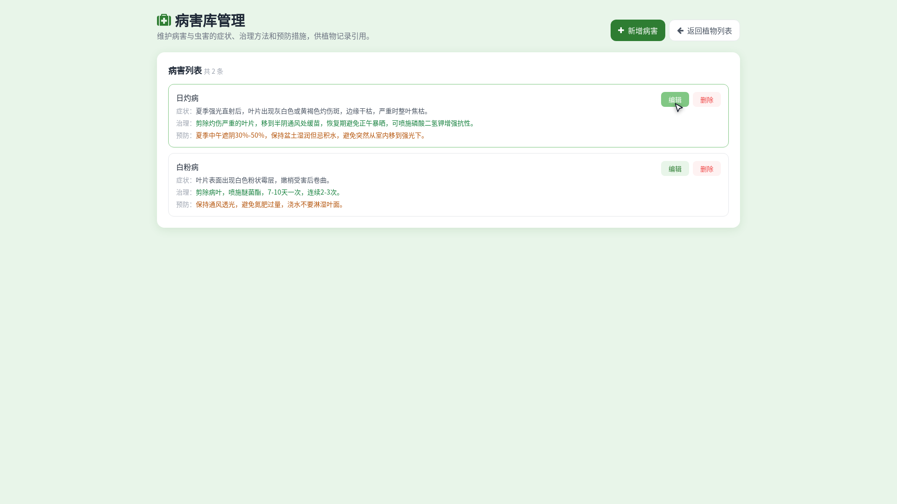

编辑 AI 自动补充的「日灼病」：

1. 在列表中找到目标病害。
2. 点击「编辑」。
3. 在弹窗中查看或补充内容。
4. 点击「保存病害」生效，或点右上角关闭。

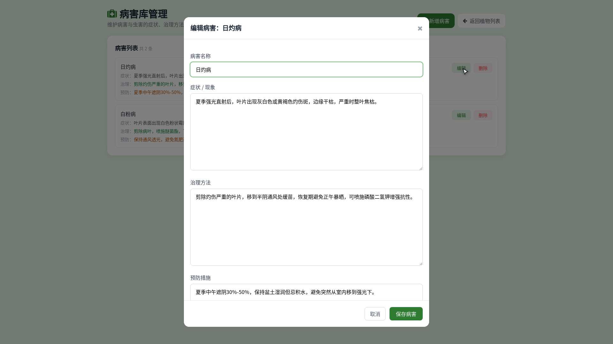

说明：

- 病害库是植物病害选择的唯一来源。
- AI 补齐自动创建的新病害也会出现在这里。
- 删除病害只删除病害库记录，不会自动删除植物记录中的病名文字。
- 按 Esc 可逐层关闭：先关录入弹窗，再返回植物列表。

---

## 4. 点击病害查看详细信息

植物卡片上的常见病害以名称展示，多个病害用逗号分隔。

### 操作步骤

1. 在搜索框输入植物名称「蓝雪花」。
2. 找到植物卡片。
3. 点击卡片上的病害名称「日灼病」。

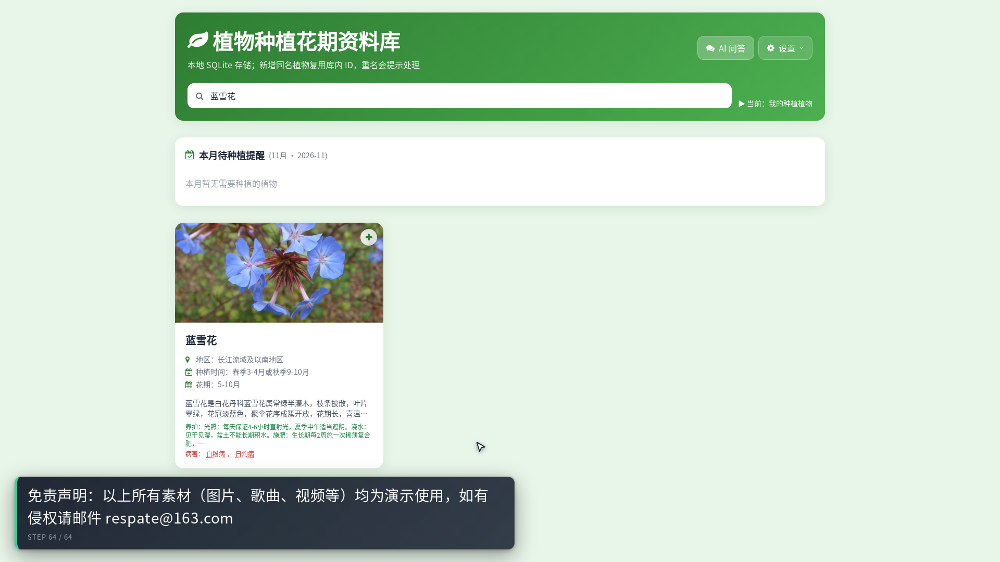

### 预期结果

弹窗展示该病害的：

- 症状 / 现象；
- 治理方法；
- 预防措施。

不需要进入病害库即可快速查看处理方法。

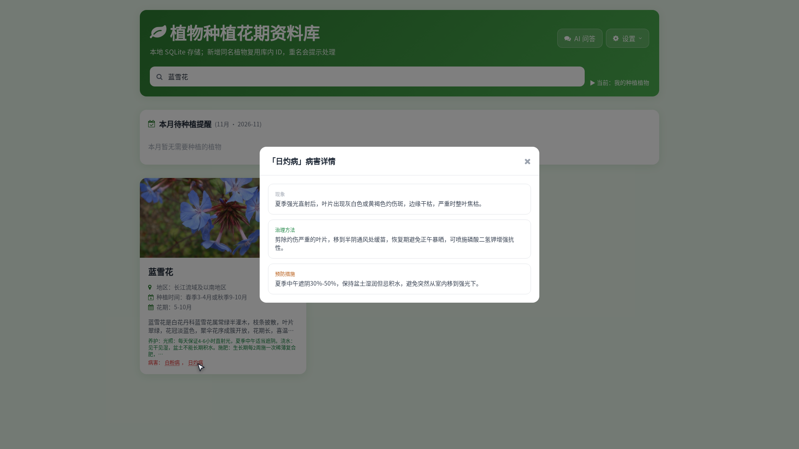

关闭方式：右上角 × 或按 Esc。

---

## 5. AI 问答

入口：右上角 **💬 AI 问答**（设置按钮左侧）。

### 使用方式

1. 打开聊天窗口。
2. 输入问题，或点击欢迎语下的示例问题。
3. 按 Enter 发送，Shift+Enter 换行。
4. 回答会显示当前使用的模型；无关问题会显示「话题限制已生效」。

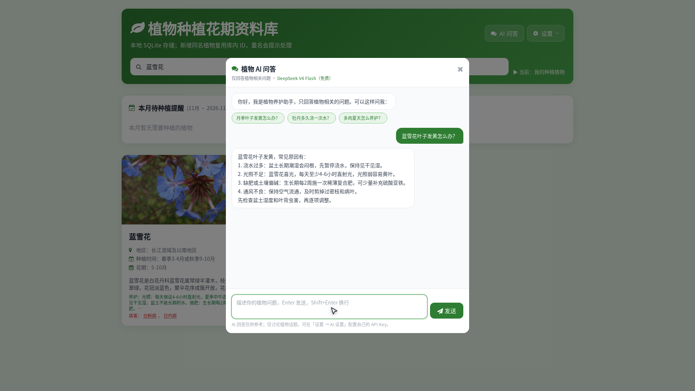

### 话题限制

- 只回答植物、花卉、园艺、种植、养护、病虫害、土壤肥料、花期、植物识别等相关问题。
- 编程、股票、医疗、法律、情感、娱乐、作业等无关问题会被拒绝，并引导回植物话题。

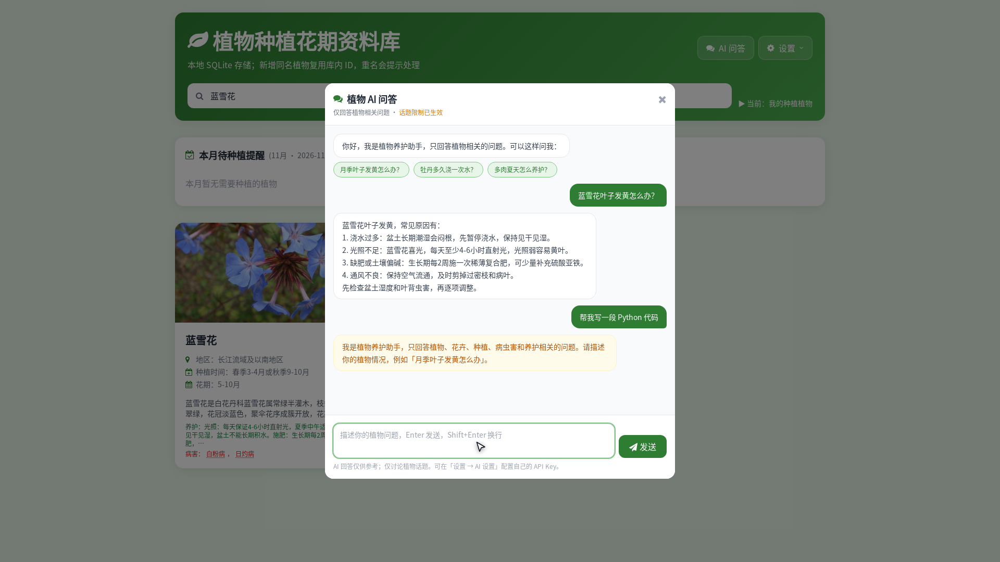

### AI 设置

入口：**设置 → ⚙️ AI 设置**。

可填写：

- API Key；
- API 地址；
- 模型名称。

保存后，AI 问答和 AI 补齐都会使用该配置；点「恢复免费 AI」可删除 Key。Key 只保存在本机，不会明文显示。

免费 AI 说明：

- 默认使用 DeepSeek V4 Flash 免密钥通道，额度用尽后自动降级到备用免费模型。
- 额度用尽会弹窗提示，并给出注册与配置指引。
- 如需使用 DeepSeek V4.1 Flash：
  - API 地址：`https://opencode.ai/inference/openai/v1`
  - 模型：`deepseek-v4.1-flash`
  - Key 从 OpenCode Console（https://opencode.ai/console）获取。

---

## 附：常见问题

**Q：图片刷新后消失？**  
A：图片会保存在本机数据中，刷新后仍然存在。

**Q：AI 回答很慢或失败？**  
A：免费通道受服务方额度和网络影响，可能需要十几秒；额度用尽会自动降级并提示。配置自己的 API Key 后更稳定。

**Q：怎样备份数据？**  
A：停止服务后备份整个 `data` 目录即可，恢复时覆盖回原位置。

**Q：换电脑后账号还在吗？**  
A：账号和数据都在本机数据目录中，迁移时需要一起复制该目录。

**Q：页面修改后需要重启吗？**  
A：先刷新浏览器；如果仍显示旧内容，再按部署说明重启服务。

---

## 免责声明

以上所有素材（图片、歌曲、视频等）均为演示使用，如有侵权请邮件 respate@163.com。
